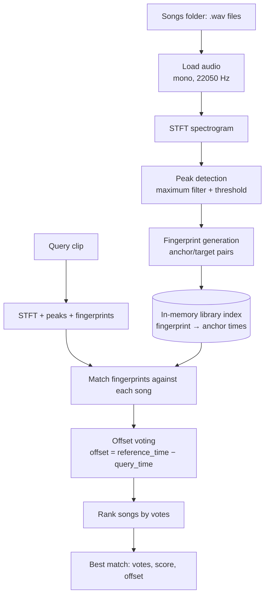

# 🎵 Music Recognition Engine

A Shazam-inspired **audio fingerprinting and music recognition system** written in Python. It identifies a song from a short audio clip by extracting spectrogram-peak fingerprints and voting on consistent time offsets.

> **This is an algorithmic signal-processing project, not machine learning.** There is no trained model, neural network, or learned parameters. Recognition relies entirely on STFT, peak detection, hash matching, and offset voting.

---

## Table of Contents

- [Features](#features)
- [Tech Stack](#tech-stack)
- [How It Works](#how-it-works)
- [Project Structure](#project-structure)
- [Installation](#installation)
- [Usage](#usage)
- [Adding New Songs](#adding-new-songs)
- [Testing Recognition](#testing-recognition)
- [Sample Results](#sample-results)
- [Visualization Warning](#-visualization-warning)
- [Configuration Reference](#configuration-reference)
- [Limitations](#limitations)
- [Future Improvements](#future-improvements)
- [Acknowledgements](#acknowledgements)

---

## Features

- Loads `.wav` songs from a local `songs/` folder, resampled to mono 22,050 Hz
- Computes a magnitude spectrogram with the Short-Time Fourier Transform (STFT)
- Detects spectral peaks using a 2D local-maximum filter plus an amplitude threshold
- Builds fingerprints from **anchor → target peak pairs** (frequency bin, frequency bin, time delta)
- Indexes the whole library in memory as a hash → anchor-times lookup per song
- Matches a query clip using **time-offset voting**
- Ranks songs and reports matching votes, score, and estimated offset
- Optional Matplotlib visualization of spectrograms, peaks, and the aligned query

---

## Tech Stack

| Library | Role |
|---|---|
| **Python** | Core language |
| **NumPy** | Array operations, peak masks |
| **Librosa** | Audio loading, resampling, STFT, plotting helpers |
| **SciPy** | `scipy.ndimage.maximum_filter` for peak detection |
| **Matplotlib** | Optional spectrogram and peak visualization |
| **collections** (`defaultdict`, `Counter`) | Hash index and offset vote counting |

---

## How It Works



### 1. Audio Loading
Songs are loaded with `librosa.load(path, sr=22050, mono=True)`, so every file is converted to mono and resampled to a consistent 22,050 Hz.

### 2. STFT / Spectrogram
`librosa.stft` is applied with `n_fft=2048` and `hop_length=512`. The absolute value gives a magnitude spectrogram showing how frequency content changes over time. One frame is `512 / 22050 ≈ 23.2 ms`.

### 3. Peak Detection
A `scipy.ndimage.maximum_filter` with a `7 × 7` neighborhood marks local maxima. A point is kept as a peak only if it equals its neighborhood maximum **and** exceeds `5%` of the spectrogram's global maximum amplitude. Peaks are then sorted by time.

### 4. Fingerprint Generation
Each peak acts as an **anchor**. It is paired with up to `FAN_OUT = 5` later peaks whose time difference falls between `TARGET_MIN = 10` and `TARGET_MAX = 100` frames. Each pair becomes:

```
fingerprint = (anchor_freq_bin, target_freq_bin, delta_time_frames)
```

stored together with the anchor's time frame. Because the fingerprint describes *relative* structure (two frequencies and the gap between them), it does not depend on where in the song the clip starts.

### 5. Library Indexing
`build_library()` scans `songs/`, fingerprints every `.wav` file, and stores for each song a dictionary mapping `fingerprint → [anchor times]`. The index lives in memory and is **rebuilt on every run**.

### 6. Query Matching
The query clip goes through the same fingerprinting pipeline. Each query fingerprint is looked up in each song's index.

### 7. Offset Voting
For every matching fingerprint, the engine computes:

```
offset = reference_time − query_time
```

Offsets are binned to the nearest 2 frames, and each match casts a vote for its bin. If the clip really comes from a song, many matches agree on one offset, producing a tall vote spike. Unrelated songs only produce a few scattered votes.

### 8. Ranking
For each song, the most-voted offset bin gives `best_votes` and `best_offset`. The score is:

```
score = best_votes / number_of_query_fingerprints
```

Songs are **sorted by `best_votes`** (descending). Songs with zero matching fingerprints don't appear in the results.

---

## Project Structure

> ⚠️ **Example layout only.** Verify names against your actual repository. The recognition script may be called `main.py`, `temp.py`, or something else.

```
musicRecognition/
├── songs/              # Reference library (WAV files to be indexed)
│   ├── song1.wav
│   ├── song2.wav
│   └── song3.wav
├── main.py             # Fingerprinting, indexing, matching, optional visualization
├── requirements.txt
└── README.md
```

- **`songs/`**: the reference library. Every `.wav` file in this folder is fingerprinted and becomes a candidate match.
- **Main script**: contains the configuration constants, `generate_fingerprints`, `build_library`, `recognize_song`, `visualize_match`, and the `__main__` test driver.

---

## Installation

```bash
git clone <your-repo-url>
cd musicRecognition

python -m venv venv
# Windows: venv\Scripts\activate
# macOS/Linux: source venv/bin/activate

pip install numpy scipy librosa matplotlib
```

Example `requirements.txt`:

```
numpy
scipy
librosa
matplotlib
```

---

## Usage

The script has no command-line arguments. All settings are constants at the top of the file, plus the test values in the `__main__` block.

1. Put `.wav` files in `songs/`.
2. Set the test song and start time in the `__main__` block.
3. Run:

```bash
python main.py
```

The script will index the library, extract a query clip from the chosen song, print ranked results, and then **open the visualization** (see the [warning](#-visualization-warning) below).

---

## Adding New Songs

1. Place a **`.wav`** file in the `songs/` folder. The current code only indexes files ending in `.wav` (case-insensitive); other formats are skipped.
2. Run the script.
3. `build_library()` fingerprints the new file and adds it to the in-memory index.
4. The song is now a candidate for matching.

Since the index is rebuilt from scratch on every execution, new songs are picked up automatically on the next run. There is no saved database file to update.

---

## Testing Recognition

The current test takes a clip from a song **already in the library** and checks that the engine ranks that song first.

Example configuration (adjust to match your code):

```python
test_song = "song3.wav"
start_second = 30
QUERY_DURATION = 10   # seconds, defined in the configuration section
```

The script then:

1. Loads `test_song` at 22,050 Hz mono.
2. Slices out `QUERY_DURATION` seconds starting at `start_second`.
3. Runs `recognize_song()` on that clip against the full library.
4. Prints ranked results.

### What the estimated offset means

The offset is where the clip lines up inside the reference song, measured in **STFT frames**. Convert to seconds with:

```
offset_seconds = offset_frames × HOP_LENGTH / SAMPLE_RATE
                = offset_frames × 512 / 22050
```

Because votes are based on *relative* offsets, the engine can recognize a clip from the middle of a song, not just from its beginning. In the sample below, an offset of 1292 frames is about **30.0 s**, which matches the test's 30-second start point.

> Note: this test uses a clean clip cut directly from the indexed file. It does not test noisy, re-recorded, or compressed audio.

---

## Sample Results

**Indexing**

| Song | Fingerprints |
|---|---:|
| song1.wav | 10,199 |
| song2.wav | 52,594 |
| song3.wav | 58,188 |

**Recognition** (query: 10 s from `song3.wav`, starting at 30 s)

| Rank | Song | Matching Votes | Score | Offset (Frames) |
|:---:|---|---:|---:|---:|
| 1 | song3.wav | 1,730 | 0.7621 | 1292 |
| 2 | song2.wav | 4 | 0.0018 | 19536 |
| 3 | song1.wav | 3 | 0.0013 | 2140 |

The correct song has a large, coherent vote cluster at one offset, while the other two songs receive only a handful of scattered votes.

> **About the score:** it is this implementation's matching score (top-bin votes divided by query fingerprint count). It is **not** a calibrated probability that the match is correct, and should not be read as a confidence percentage.

---

## ⚠️ Visualization Warning

**Plotting can be extremely slow and resource-heavy.**

`visualize_match()` loads the full reference song, computes its spectrogram, detects peaks again, and draws full-length spectrograms with thousands of scatter markers using Matplotlib. During one test, rendering took **approximately one hour**, even though the recognition results were produced much faster.

Things to know:

- Visualization is **computationally and graphically expensive**.
- **Recognition and plotting are separate operations.** Time spent rendering the graph is not recognition-engine time.
- Full-pipeline timings (indexing + recognition) have **not been formally benchmarked**. Only the matching stage appeared very fast in the observed test.
- Visualization is **optional**; you don't need it to identify songs.
- **In the current code, `visualize_match(...)` is called automatically** at the end of the `__main__` block. To skip it, comment out or remove that call:

```python
# visualize_match(
#     query_audio,
#     best_song_path,
#     offset
# )
```

Reducing plot cost (for example, plotting only the matched region or fewer peaks) is listed under future improvements.

---

## Configuration Reference

All values below come from the code's configuration section:

| Constant | Value | Meaning |
|---|---:|---|
| `SONGS_FOLDER` | `"songs"` | Library directory |
| `SAMPLE_RATE` | `22050` | Resampling rate (Hz) |
| `N_FFT` | `2048` | STFT window size |
| `HOP_LENGTH` | `512` | STFT hop size (samples) |
| `QUERY_DURATION` | `10` | Query clip length (seconds) |
| `TARGET_MIN` | `10` | Min frame gap between anchor and target |
| `TARGET_MAX` | `100` | Max frame gap between anchor and target |
| `FAN_OUT` | `5` | Max targets paired per anchor |

Hardcoded in the functions: `7 × 7` maximum-filter size, `5%` peak amplitude threshold, and `2`-frame offset bin width.

---

## Limitations

- **Only `.wav` files** are indexed by the current loader filter.
- The index is **rebuilt every run** and kept in memory; nothing is saved to disk.
- Matching loops over every song, so cost grows with library size. No inverted global index is used.
- Pure-Python loops for pairing and voting; large libraries will be slow.
- Tested on a **3-song library** with a **clean clip taken from the indexed file**. Robustness to background noise, microphone capture, compression, or pitch/tempo changes has not been evaluated.
- Fingerprints use raw linear FFT bin indices, with no hashing or quantization.
- Ranking uses vote count only; the score is a normalized heuristic, not a probability.
- No unit tests or formal benchmarks.
- This project does **not** claim production-level, Shazam-grade accuracy.

---

## Future Improvements

- Make visualization optional via a flag, and plot only the matched region
- Persist the fingerprint index to disk to avoid re-indexing
- Support MP3/FLAC and other formats
- Build a global inverted index (hash → song, time) for faster lookup
- Pack fingerprints into compact integer hashes
- Test with noisy, recorded, and compressed queries
- Add a command-line interface and proper benchmarks
- Add unit tests

---

## Acknowledgements

Inspired by the approach described in *"An Industrial-Strength Audio Search Algorithm"* by Avery Wang (Shazam). This project is an independent, simplified educational implementation and is not affiliated with Shazam.

Built with [Librosa](https://librosa.org/), [NumPy](https://numpy.org/), [SciPy](https://scipy.org/), and [Matplotlib](https://matplotlib.org/).
